I'm a backend developer from Dnipro, Ukraine. I build APIs, real-time services and data pipelines with Node.js, TypeScript and Python.

- 🔭 **Working on:** a real-time multiplayer game backend and the architecture of a microservice EdTech platform
- 🧱 **Into:** Clean Architecture, DDD, modular monoliths and microservices
- 🤖 **Daily tools:** Claude Code and Antigravity for AI-assisted development
- 🌍 **Open to:** remote backend roles

## Tech stack

<table>
  <tr>
    <td><b>Backend</b></td>
    <td></td>
  </tr>
  <tr>
    <td><b>Data</b></td>
    <td></td>
  </tr>
  <tr>
    <td><b>Frontend</b></td>
    <td></td>
  </tr>
  <tr>
    <td><b>DevOps</b></td>
    <td></td>
  </tr>
</table>

## GitHub stats

<!-- Cards are generated daily by .github/workflows/profile.yml, so they never depend on someone else's server -->
<picture>
  <source media="(prefers-color-scheme: dark)" srcset="profile-summary-card-output/github_dark/0-profile-details.svg" />
  
</picture>

<picture>
  <source media="(prefers-color-scheme: dark)" srcset="profile-summary-card-output/github_dark/3-stats.svg" />
  
</picture>
<picture>
  <source media="(prefers-color-scheme: dark)" srcset="profile-summary-card-output/github_dark/2-most-commit-language.svg" />
  
</picture>

<b>More stats</b> (click to expand)

 

<picture>
  <source media="(prefers-color-scheme: dark)" srcset="profile-summary-card-output/github_dark/1-repos-per-language.svg" />
  
</picture>
<picture>
  <source media="(prefers-color-scheme: dark)" srcset="profile-summary-card-output/github_dark/4-productive-time.svg" />
  
</picture>

## Contribution snake

<picture>
  <source media="(prefers-color-scheme: dark)" srcset="https://raw.githubusercontent.com/DmitriyPechenyuk0/DmitriyPechenyuk0/output/github-snake-dark.svg" />
  
</picture>

## Let's talk

